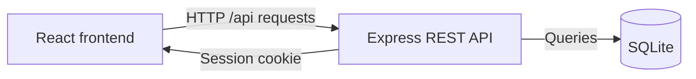

<div align="center">

# DeskFlow

**A streamlined help desk ticketing system for customers and support agents.**

React · Express · SQLite · Figma

[Features](#features) · [Getting started](#getting-started) · [Architecture](#architecture) · [API](#api-overview) · [Design](#design)

</div>

---

## Overview

DeskFlow is a role-based support ticket application developed for the **Web Programming** course at **Ilia State University (2026)**. Customers can submit requests and follow their progress; support agents can review tickets, respond, and manage their status.

The interface is built with React, the REST API runs on Express, and the application stores users, tickets, and comments in a relational SQLite database.

## Features

| Customers | Support agents |
| --- | --- |
| Register, sign in, and sign out | Sign in and view all tickets |
| Create tickets with a category and priority | Update ticket statuses |
| View their own tickets | Reply to ticket conversations |
| Edit their own tickets while open | Delete tickets |
| Add, edit, and delete their own comments | Delete comments where permitted |

**Interface:** Search, filter and sort tickets; view ticket details and conversations; use light or dark appearance. Actions are exposed according to the signed-in user's role.

**Security:** Passwords are hashed with bcrypt, login uses HTTP-only session cookies, and Express checks authorization on protected endpoints. Hiding a UI control is not the security boundary—the API enforces permissions.

> **Current scope:** The application is designed for a local classroom MVP demonstration. It is not configured for public production deployment.

## Frontend engineering

My contribution focused on the React interface, original Figma design and integration with the Express API. The frontend separates routed pages, reusable UI components, shared application state, ticket filtering utilities, request services and response adapters. The light/dark preference is stored locally. Server-side authorization and database implementation are the work of my teammate.

## Tech stack

| Layer | Technologies |
| --- | --- |
| Frontend | React, Vite, React Router, Lucide React, CSS |
| Backend | Node.js, Express |
| Database | SQLite (`better-sqlite3`) |
| Authentication | `express-session`, bcrypt |
| Design | Figma |
| Collaboration | Git, GitHub, feature branches and pull requests |

## Architecture



During local development, the **Vite proxy** forwards frontend `/api` requests to the Express server. The browser never queries SQLite directly.

### Repository structure

```text
deskflow-helpdesk/
├── frontend/
│   ├── public/
│   ├── src/
│   │   ├── components/    # Reusable interface pieces
│   │   ├── data/          # Shared UI options
│   │   ├── pages/         # Dashboard, tickets, authentication
│   │   ├── services/      # API requests and response adapters
│   │   ├── styles/        # DeskFlow styling
│   │   ├── utils/         # Ticket helpers
│   │   ├── App.jsx        # Routes
│   │   ├── context.jsx    # Shared application state
│   │   └── main.jsx       # Entry point
│   └── vite.config.js
├── backend/
│   ├── db/                # SQLite connection and seed script
│   ├── middleware/        # Authentication and role checks
│   ├── routes/            # Auth, tickets, comments
│   └── server.js
├── database/
│   └── schema.sql         # Relational schema
├── docs/
│   └── api-tests.http     # REST Client request examples
└── README.md
```

## Getting started

Requires Git, Node.js 22+ and npm. Run the following only in a new clone; seeding resets the database.

```sh
git clone https://github.com/mefrinthearea/deskflow-helpdesk.git
cd deskflow-helpdesk
npm --prefix backend ci
npm --prefix frontend ci
node -e "const fs=require('fs');const p='backend/.env';if(!fs.existsSync(p))fs.writeFileSync(p,'PORT=3000\nSESSION_SECRET='+require('crypto').randomBytes(32).toString('hex')+'\n')"
npm --prefix backend run seed
npm start
```

Open the local URL printed by Vite (usually http://localhost:5173). Express uses port 3000. For subsequent launches, run `npm start` from the repository root without seeding. If the combined launcher fails, start `npm --prefix backend start` and `npm --prefix frontend run dev` in separate terminals.

See [classroom launch and troubleshooting](docs/classroom-launch.md) for platform-specific instructions.

### Seeded demo accounts

These accounts are created by the base seed script for **local demonstrations only**.

| Role | Email | Password |
| --- | --- | --- |
| Customer | `customer@test.com` | `Test1234!` |
| Customer | `customer2@test.com` | `Test1234!` |
| Support agent | `agent@test.com` | `Test1234!` |

New registrations receive the **customer** role. An agent account is provided through the seed data; users cannot choose the agent role during registration.

## API overview

All endpoints use the `/api` prefix. Protected requests require a valid session.

| Method | Route | Purpose |
| --- | --- | --- |
| `POST` | `/api/auth/register` | Register a customer |
| `POST` | `/api/auth/login` | Sign in |
| `GET` | `/api/auth/me` | Get current user |
| `POST` | `/api/auth/logout` | Sign out |
| `GET` | `/api/tickets` | List tickets visible to the user |
| `GET` | `/api/tickets/:id` | Get a ticket and its comments |
| `POST` | `/api/tickets` | Create a ticket (customer) |
| `PUT` | `/api/tickets/:id` | Edit a ticket or update its status, depending on role |
| `DELETE` | `/api/tickets/:id` | Delete a ticket (agent) |
| `POST` | `/api/tickets/:id/comments` | Add a comment |
| `PUT` | `/api/comments/:id` | Edit an authored comment |
| `DELETE` | `/api/comments/:id` | Delete a permitted comment |

The backend returns JSON error responses with appropriate HTTP status codes (for example, `401` for unauthenticated requests and `403` for forbidden actions). Request examples are available in [`docs/api-tests.http`](docs/api-tests.http).

### Data model

- **Users** have an ID, name, email, hashed password, and role.
- **Tickets** belong to a user and include title, description, category, priority, status, and creation time.
- **Comments** belong to both a ticket and an author; deleting a ticket cascades to its comments.

The supported ticket priorities are **Low, Medium, High**. Ticket statuses are **Open, In progress, Resolved, Closed**.

## Design

The UI was created as an original Figma design, with a bright aqua/light appearance and a midnight/dark appearance. The goal is a readable, practical help desk—not a generic starter template.

**[View the DeskFlow design in Figma](https://www.figma.com/design/xFTeOWPtJSoxYR5h2kPbqi?node-id=2-2)**


## Live demo checklist

1. Start Express and Vite locally.
2. Log in as a customer and create a ticket.
3. Open the ticket, add a comment, and refresh to show persistence.
4. Log out and sign in as an agent.
5. Locate the ticket, reply, and change its status.
6. Demonstrate server-enforced permissions (for example, a customer delete attempt returns `403`).

## Team and contributions

Team 07 has two members. The Git history and pull requests document each person's contributions.

- **Ekaterine Kapanadze** ([`@ekaterine22`](https://github.com/ekaterine22)): Express API, SQLite database, authentication and roles, API tests.
- **Giorgi Meparishvili** ([`@mefrinthearea`](https://github.com/mefrinthearea)): frontend, Figma design, React integration.


## Verification and limitations

The repository includes ticket utility tests in `frontend/tests/tickets.test.mjs` and HTTP request examples in `docs/api-tests.http`. Run the utility tests with `node --test frontend/tests/tickets.test.mjs` from the repository root. Automated browser coverage and production session storage are not established; the default in-memory session store is intended for local development.

## Project status

Verified on a fresh clone of `main`: registration, login and logout, customer ticket creation, editing and comments, agent status changes and deletion, Demonstrate server-enforced permissions: in docs/api-tests.http, log in as a customer and send the DELETE request, which returns 403.
---

<div align="center">

**DeskFlow** · Web Programming · Ilia State University · 2026

</div>
